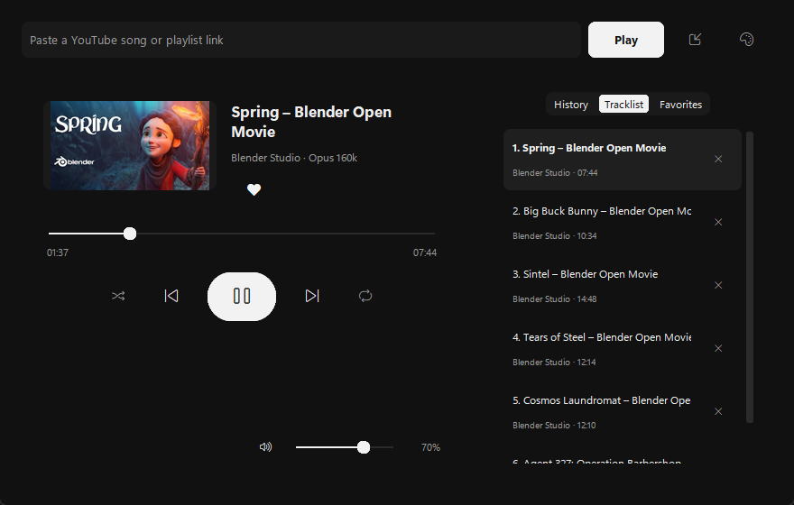
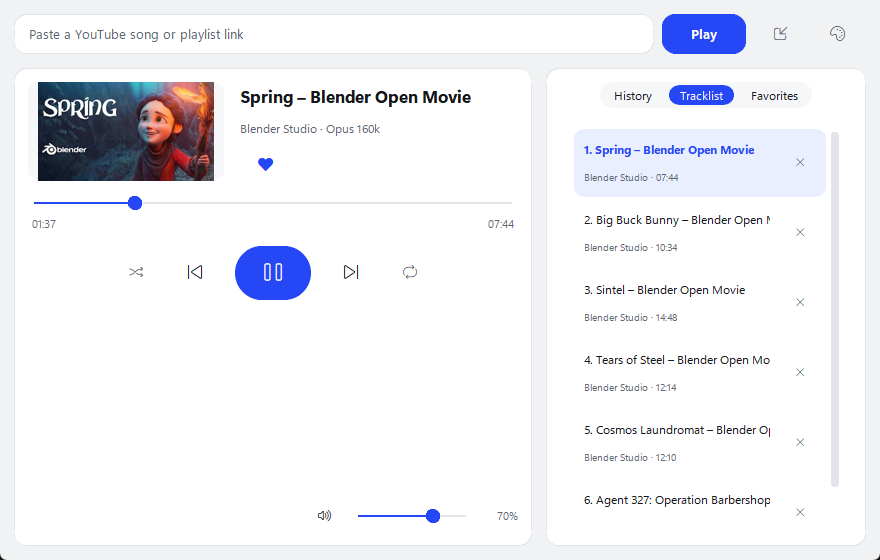
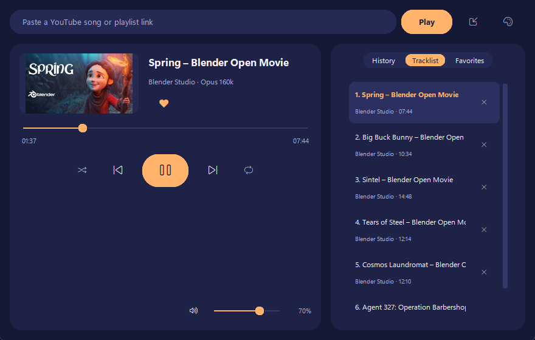
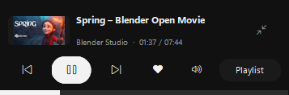

# Lightweight YouTube Player

A small Windows music player for YouTube. Paste a song or playlist link and it plays the **audio only**: no browser, no video, no ads. It sits quietly in the corner while you work.



## Download

**[⬇ Download LightweightYouTubePlayer.exe](https://github.com/Dinushan-S/lightweight-youtube-player/releases/latest/download/LightweightYouTubePlayer.exe)** (Windows 10 / 11, 64-bit)

No installation is needed: download it and double-click. All releases are on the [Releases page](https://github.com/Dinushan-S/lightweight-youtube-player/releases).

> **Windows SmartScreen:** the `.exe` isn't code-signed, so Windows may say "Windows protected your PC". Click **More info → Run anyway**. You can also [build it yourself](#build-from-source) from this code.

## Features

- **Paste and play:** single songs, whole playlists, or a song inside a playlist (it starts at that song while the rest of the list loads).
- **Light on your PC:** audio only, played by a hidden [mpv](https://mpv.io) process. No browser tabs, no video decoding.
- **Controls:** play / pause, previous, next, shuffle, repeat (off, all, one), seek, volume with mute and mouse-wheel steps.
- **Docked mini player:** one click (or **Ctrl+M**) hides the window and pins a thin progress line to the top of your screen. Hover it for the cover, controls, volume, favorite and the playlist; drag it anywhere along the top; unpin it if you don't want it always on top.
- **Your own playlists:** make playlists in the Playlists tab and add songs with ＋ or by right-clicking any song. Reorder with Move up / Move down, remove with ✕.
- **Your YouTube playlists (optional):** connect your Google account with a code at google.com/device, and your music playlists (private ones too) and liked songs show up in the Playlists tab. Read-only. Needs a Google client file, see [Google sign-in](#google-sign-in-optional).
- **Works in the background:** keyboard and headset media keys control it from any app, and closing or minimizing hides it to the system tray (right-click the tray icon to quit).
- **Favorites:** heart a song from the main window or the dock; find it again in the Favorites tab.
- **History:** every song you played, searchable. Press Play with an empty link box to pick up your last song.
- **Three minimalist themes:** by default it follows Windows (Graphite in dark mode, Porcelain in light mode), or pick Graphite, Porcelain or Indigo yourself.

| Porcelain | Indigo |
|---|---|
|  |  |

Docked mini player, opened on hover:



The full feature list, with every detail, is in [memo.md](memo.md).

## How to use

1. Copy a YouTube link (a song, a playlist, or a song inside a playlist).
2. Paste it into the box at the top and press **Play** (or Enter).
3. Use the palette button (top-right) to change the theme, and the dock button next to it to shrink the player to the top of your screen.

Your history, favorites, playlists and theme are saved in `%USERPROFILE%\.local_ytplayer\player.db` on your PC. Nothing is sent anywhere except the requests to YouTube needed to play the music.

Screenshots use Blender Studio's open movies as example tracks.

## Build from source

You need Windows, [Python 3.12](https://www.python.org/downloads/) and an `mpv.exe`.

```powershell
git clone https://github.com/Dinushan-S/lightweight-youtube-player.git
cd lightweight-youtube-player
python -m venv .venv
.\.venv\Scripts\python -m pip install -r requirements.txt
```

Put mpv in a `bin` folder in the project (`bin\mpv.exe`, plus `vulkan-1.dll` if your mpv build ships it). Get it from the [mpv website](https://mpv.io/installation/) or with `winget install mpv-player.mpv-CI.MSVC`. The app also finds mpv installed by winget or on your `PATH`.

Run it:

```powershell
.\.venv\Scripts\python main.py
```

Run the tests:

```powershell
.\.venv\Scripts\python -m pytest -q
```

Build the `.exe` (output: `dist\LightweightYouTubePlayer.exe`):

```powershell
.\.venv\Scripts\python -m pip install pyinstaller
.\build.ps1
```

### Google sign-in (optional)

The Google button only appears when the app finds a Google OAuth client file. To make your own:

1. In [Google Cloud](https://console.cloud.google.com), create a project and enable **YouTube Data API v3**.
2. Set up the **OAuth consent screen** (External, Testing) with the scope `.../auth/youtube.readonly`, and add your Google account under **Test users**.
3. Create an **OAuth client ID** of type **TVs and Limited Input devices** and download its JSON.
4. Put the `client_secret_….json` file in the project folder. It's gitignored, and `build.ps1` bundles it into the `.exe`.

In Testing mode Google ends the sign-in after 7 days, so you connect again once a week.

## How it works

- **UI:** [CustomTkinter](https://github.com/TomSchimansky/CustomTkinter) (`src/player/ui.py`, `src/player/mini_player.py`).
- **Finding the audio:** [yt-dlp](https://github.com/yt-dlp/yt-dlp) gets the best audio-only stream (Opus, then M4A) (`src/player/resolver.py`).
- **Playing it:** a hidden mpv process, controlled over a named pipe (`src/player/mpv_engine.py`).
- **State:** queue, shuffle and repeat (`src/player/queue_manager.py`), controller (`src/player/controller.py`), SQLite storage (`src/player/database.py`).

## Disclaimer

This is an independent project. It is not affiliated with, endorsed by, or connected to YouTube or Google. It streams publicly available content for personal listening; respect YouTube's Terms of Service and the rights of the creators whose music you play.

## License

[MIT](LICENSE) © 2026 Dinushan-S.

The Windows `.exe` also bundles mpv (GPL-2.0-or-later), yt-dlp and other open-source components; see [THIRD_PARTY_NOTICES.md](THIRD_PARTY_NOTICES.md).

---

### Download

| File | For |
|---|---|
| [**LightweightYouTubePlayer.exe**](https://github.com/Dinushan-S/lightweight-youtube-player/releases/latest/download/LightweightYouTubePlayer.exe) | Windows 10 / 11 (64-bit), no install needed |
