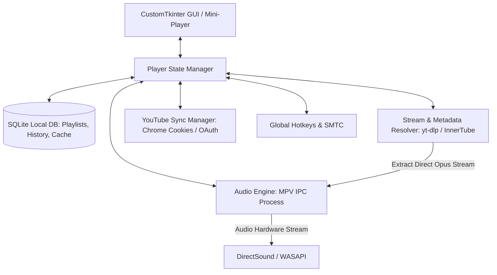

# Architecture & Implementation Plan: Ultra-Lightweight YouTube Audio Player

> **Target Goal**: Replace heavy browser instances (>1 GB RAM, high CPU) with a dedicated, ultra-low resource audio player (<50–70 MB RAM, <0.5% CPU) tailored for uninterrupted work productivity. Plays highest-fidelity audio streams (Opus 48kHz, no video decoding), supports YouTube account/playlist synchronization, custom local playlists, history tracking, and global media keys.

---

## 1. Research & Architectural Analysis

### 1.1 Audio Extraction & Streaming (Zero-Video, Lowest Resource)
* **The Problem with Browsers**: Browsers like Chrome decode full VP9/AV1 video frames, render complex WebGL/DOM trees, run JavaScript engines, and load heavy telemetry and ads, easily consuming 1 GB to 2.5 GB of RAM.
* **Audio-Only Stream Resolution**:
  * YouTube provides demuxed audio-only streams via Google Video CDNs (`googlevideo.com`).
  * Format: `itag 251` (WebM Opus codec, 48 kHz stereo, ~160 kbps) and `itag 140` (M4A AAC codec, 44.1 kHz stereo, ~128 kbps).
  * Using `yt-dlp` (already verified and installed on user system: v2026.10.26) or lightweight InnerTube API client, we query direct stream URLs on-demand in <300ms.
  * **Bandwidth & CPU Savings**: Bandwidth drops by ~85–90% compared to 1080p video, and GPU/CPU video decoding overhead is eliminated (0% video decode CPU).

### 1.2 Audio Fidelity & The "Lossless" Clarification
* **Audio Format Reality**: YouTube does *not* host or stream uncompressed lossless audio (e.g., FLAC 1411 kbps or 24-bit 96kHz). All audio uploaded to YouTube is transcoded into Opus (up to 160 kbps) and AAC (up to 128 kbps, or 256 kbps on YouTube Music Premium).
* **Perceptual Transparency**: The Opus codec at 160 kbps 48kHz is psychoacoustically transparent—blind listening tests confirm it is indistinguishable from uncompressed CD audio for 99.9% of listeners.
* **Player Configuration**: The player strictly enforces `bestaudio[ext=opus]/bestaudio` with zero resampling, feeding the pristine Opus bitstream directly to the audio output device.

## 1.3 Audio Playback Engine (Confirmed Specification: Portable Headless MPV IPC)
* **Provisioning**: The player manages a self-contained portable `mpv.exe` in the application's `bin/` directory (auto-verified and bootstrapped on first launch). No administrator rights needed, and zero modification to system PATH.
* **Architecture**: The UI spawns MPV in headless audio-only mode (`--no-video --idle --input-ipc-server=\\.\pipe\mpv_music_player`).
* **IPC Control**: Two-way JSON IPC enables:
  * Precise timeline seek (`seek <seconds> absolute`).
  * Continuous elapsed time and duration events (`time-pos`, `duration`).
  * Volume and mute control (`set volume <0-100>`).
  * Stream buffering and automatic gapless queue transitions.
* **Resource Profile**: **~18–25 MB RAM** and **<0.3% CPU** during active playback.

### 1.4 YouTube Account & Playlist Synchronization (Confirmed Specification)
Based on environment tests and user requirements, the player adopts a **Hybrid Two-Tier Sync Engine**:

1. **Tier 1 — Instant URL Sync (Zero Authentication)**:
   * Supports any **Public** or **Unlisted** YouTube / YouTube Music playlist URL.
   * User simply pastes the URL (e.g. `https://www.youtube.com/playlist?list=...`).
   * The player queries `yt-dlp` in the background, extracts track metadata (title, channel, duration, thumbnail), stores them in SQLite, and enables one-click "Sync / Refresh".
   * 100% reliable, zero credential dependency, unaffected by browser locks.

2. **Tier 2 — Private Library & Liked Music Sync (Google Device OAuth)**:
   * Supports **Private playlists** and user's **Liked Music** collection.
   * Utilizes Google's official TV / Device OAuth flow:
     * App displays an 8-character user code and link: `https://www.google.com/device`.
     * User opens the link on their browser or phone, clicks "Allow" once.
     * The app securely exchanges and persists the token locally in `~/.local_ytplayer/auth.json`.
     * Syncs private playlists without touching locked browser cookie databases.

3. **Single Video & Song URL Paste**:
   * Pasting any YouTube or YouTube Music song link (`watch?v=...`, `youtu.be/...`, `music.youtube.com/...`) starts playback within <500ms and offers "+ Add to Playlist" or "+ Add to Queue".

### 1.5 GUI Framework & Resource Footprint
* **Framework Selection**: Python 3.12 + **CustomTkinter** (or PySide6).
  * **Memory Footprint**:
    * CustomTkinter / Tkinter: **~35 MB – 50 MB RAM**.
    * Electron / Chromium wrappers: **> 300 MB RAM** (Eliminated).
    * Python + CustomTkinter combines modern dark aesthetics (rounded corners, smooth sliders, custom scrollbars) with near-zero idle CPU.
  * Total combined memory (GUI + MPV audio backend): **~55 MB – 70 MB total RAM** (vs 1,200+ MB for Chrome).

---

## 2. Impeccable UI/UX Design Specification

**Design Mode**: **Operate** (Productivity-focused, clean, distraction-free, zero visual noise).

### 2.1 Color Palette & Theme (Obsidian Slate)
* **Background Primary**: `#0b0f17` (Deep Obsidian Void)
* **Surface Secondary**: `#161f30` (Card & Sidebar background)
* **Surface Hover / Active**: `#222f46`
* **Accent Primary**: `#38bdf8` (Vibrant Electric Cyan / Sky Blue)
* **Text Primary**: `#f8fafc` (Slate 50, high contrast crisp typography)
* **Text Muted**: `#94a3b8` (Slate 400, secondary timestamps & channel names)
* **Divider / Borders**: `#1e293b`

### 2.2 Layout Architecture
```
+-----------------------------------------------------------------------------------+
|  [⚡ Paste YouTube URL...]                       [▶ Play] [+ Queue]  [⚙ Settings] |
+-----------------------+-----------------------------------------------------------+
| 📂 LIBRARY            | 🎶 CURRENT PLAYLIST / QUEUE                                |
| ───────────────       | ───────────────────────────────────────────────────────── |
| ★ Liked Music (YT)    | #  Title                       Artist         Duration    |
| 📁 Work Flow Focus    | 1. Lofi Chill Beats            ChilledCow     03:24   ▶   |
| 📁 Synthwave Coding   | 2. Deep Focus Ambient          Brian Eno      05:12       |
| 📁 Ambient Space      | 3. Resident Evil Safe Room     Capcom Sound   02:45       |
|                       |                                                           |
| 🕒 RECENT HISTORY     |                                                           |
| ───────────────       |                                                           |
| • Track A (10m ago)   |                                                           |
| • Track B (1h ago)    |                                                           |
|                       |                                                           |
| [+ New Playlist]      |                                                           |
+-----------------------+-----------------------------------------------------------+
| [⏮] [ ▶ / ⏸ ] [⏭]   [01:24 / 03:24] ═══════════🔘───────────    [🔊 80%] [🗗 Mini] |
| 🎵 Lofi Chill Beats • ChilledCow                [Bitrate: Opus 160k (Audio-Only)] |
+-----------------------------------------------------------------------------------+
```

### 2.3 Modes of Operation
1. **Full Workspace View (Standard)**:
   * Left Sidebar: Synced YouTube playlists, user-created local playlists, recent playback history.
   * Center Stage: Tracklist with search filter, drag-and-drop ordering, track duration, and status indicators.
   * Bottom Bar: Transport controls, scrubbable seek bar with buffer indicator, volume, loop/shuffle toggles, audio stream telemetry.
2. **Compact Floating Mini-Player (`340x80 px`)**:
   * One-click toggle (`Ctrl + M` or mini-icon).
   * Shrinks the player down to an ultra-compact floating widget with track title, play/pause, next, progress bar, and volume. Perfect for pinning on top while coding.
3. **Headless Tray Mode**:
   * Minimizing the window sends it directly to the Windows System Notification Area (System Tray).
   * Background music continues playing at ~0.2% CPU without cluttering the Windows Taskbar.

### 2.4 Windows System & Productivity Integrations
* **System Media Transport Controls (SMTC)**: Native Windows integration—pressing keyboard media keys (`Play/Pause`, `Next Track`, `Previous Track`) or headset buttons controls playback even when the window is hidden or when working in another app.
* **Global Hotkeys**:
  * `Ctrl + Alt + Space`: Play / Pause
  * `Ctrl + Alt + Right`: Next Track
  * `Ctrl + Alt + Left`: Previous Track
  * `Ctrl + Alt + V`: Quick-paste YouTube URL from clipboard and immediately play

---

## 3. Data & Storage Model

Local persistence using an embedded SQLite database (`~/.local_ytplayer/player.db`):

```sql
-- Playlists (both synced YT playlists and custom local playlists)
CREATE TABLE playlists (
    id TEXT PRIMARY KEY,
    title TEXT NOT NULL,
    source_type TEXT NOT NULL, -- 'youtube_synced' or 'local'
    source_url TEXT,
    last_synced_at TIMESTAMP,
    created_at TIMESTAMP DEFAULT CURRENT_TIMESTAMP
);

-- Playlist Tracks
CREATE TABLE playlist_tracks (
    id INTEGER PRIMARY KEY AUTOINCREMENT,
    playlist_id TEXT REFERENCES playlists(id) ON DELETE CASCADE,
    video_id TEXT NOT NULL,
    title TEXT NOT NULL,
    channel TEXT,
    duration_sec INTEGER,
    thumbnail_url TEXT,
    track_order INTEGER
);

-- Playback History
CREATE TABLE history (
    id INTEGER PRIMARY KEY AUTOINCREMENT,
    video_id TEXT NOT NULL,
    title TEXT NOT NULL,
    channel TEXT,
    duration_sec INTEGER,
    played_at TIMESTAMP DEFAULT CURRENT_TIMESTAMP,
    play_count INTEGER DEFAULT 1
);

-- App Settings
CREATE TABLE settings (
    key TEXT PRIMARY KEY,
    value TEXT
);
```

---

## 4. Component Architecture



---

## 5. Step-by-Step Implementation Roadmap

* **Phase 1: Audio Core & Stream Resolver**
  * Implement `StreamResolver` using `yt-dlp` python interface for rapid single video & playlist metadata extraction.
  * Implement `MpvController` managing an isolated headless MPV child process communicating over JSON IPC (`\\.\pipe\mpv_music_player`).
  * Verify audio-only streaming, seeking, volume, and playback state callbacks.

* **Phase 2: Database & Playlist Engine**
  * Build `DatabaseManager` (SQLite) with auto-migration.
  * Implement history tracking (recording every played track with timestamp).
  * Implement local playlist CRUD (create empty playlist, add track from URL, delete, reorder).

* **Phase 3: GUI Development (Full + Mini Player)**
  * Build the Obsidian Slate UI using `CustomTkinter`.
  * Construct Library sidebar (Synced playlists, Local playlists, History).
  * Build interactive track table with instant play, queueing, and context menus.
  * Build Seek bar with live second-by-second updates and smooth dragging.
  * Build Mini-Player mode toggle (`340x80 px`).

* **Phase 4: YouTube Sync Integration**
  * Implement instant URL sync for Public and Unlisted YouTube / YouTube Music playlist links (zero auth, fast metadata caching).
  * Implement Google Device Flow OAuth (`google.com/device` + 8-character code) for syncing Private playlists and Liked Music collections safely without browser cookie conflicts.
  * Implement instant single-video URL paste listener for immediate streaming and playlist addition.

* **Phase 5: Productivity Enhancements & Polish**
  * Integrate Windows SMTC / global hotkeys.
  * System tray icon with right-click menu (Play/Pause, Next, Quit).
  * Packaging into a standalone launcher.
